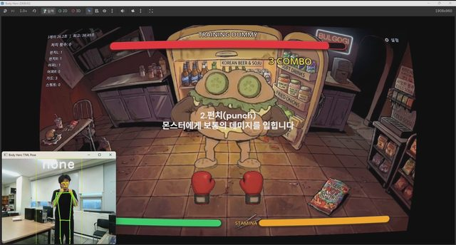
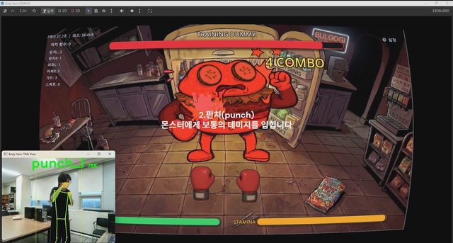
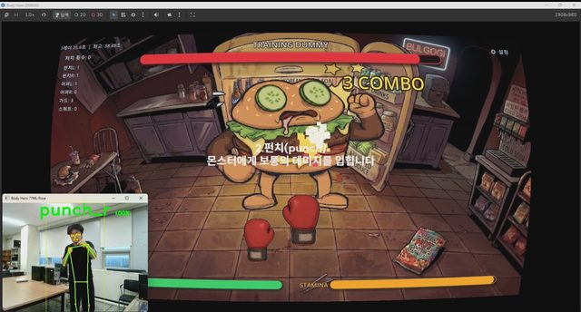
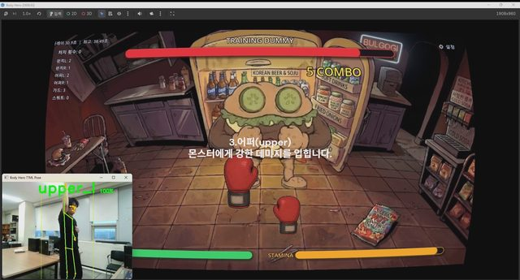
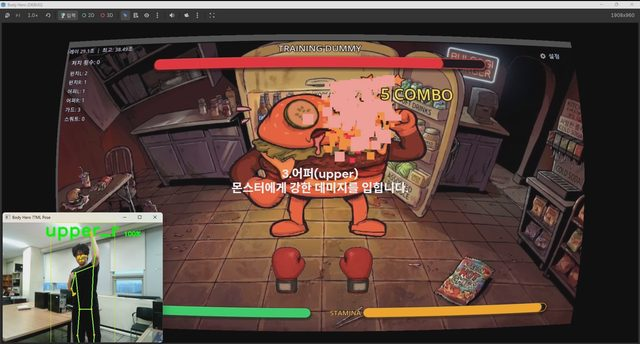
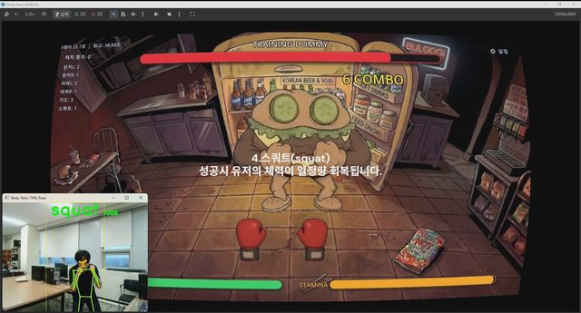
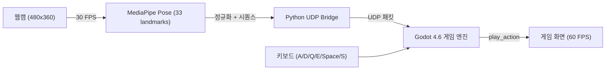
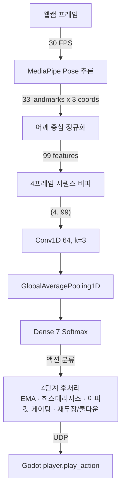

# Body Hero

> 웹캠 하나로 즐기는 2D 복싱 체감형 운동 게임 — **당신의 주먹이 곧 조이패드!**
>
> Godot 4.6 · MediaPipe Pose · 경량 1D-CNN(4프레임 Conv1D+GAP) 실시간 동작 인식

[](https://github.com/wlgptjd333/body-hero/releases/latest)


전용 컨트롤러나 VR 장비 없이, 일반 USB·노트북 웹캠만으로 펀치·어퍼컷·가드·스쿼트를 인식해 몬스터와 싸웁니다.

## 🥊 7가지 동작

| | |
|:---:|:---:|
| <br>**대기 (None)** | <br>**가드 (Guard)** · 받는 데미지 감소 |
| <br>**왼손 펀치 (Punch L)** · 보통 데미지 | <br>**오른손 펀치 (Punch R)** · 보통 데미지 |
| <br>**왼손 어퍼컷 (Upper L)** · 강한 데미지 | <br>**오른손 어퍼컷 (Upper R)** · 강한 데미지 |
| <br>**스쿼트 (Squat)** · 체력 회복 | |

> 💡 **어퍼컷 요령:** 팔꿈치를 직각에 가깝게 유지한 채 아래에서 위로 올리면 펀치로 잘못 인식되는 경우가 줄어듭니다.

## 🆕 v1.1.0 바뀐 점

| 항목 | v1.0.0 (졸업작품 시연) | v1.1.0 |
|---|---|---|
| 동작 인식 모델 | 시연용 4프레임 Conv1D+GAP | 같은 구조를 논문 반복 비교 실험 설정으로 다시 학습 |
| 정밀(Precise) 직선 펀치 확정 | 2프레임 | **3프레임** |
| 어퍼컷 정답 (같은 기록 재생) | 37.3% | **91.0%** |
| 다른 공격이 먼저 나간 비율 | 24.8% | **4.0%** |

- 실험자 1명의 실제 플레이 기록 기준입니다. 자세한 내용은 [`tools/MODEL_v1.1.md`](tools/MODEL_v1.1.md)를 보세요.
- 더 빠른 반응을 원하면 설정에서 **균형(Balanced, 2프레임)** 프로필을 고르세요.

## 🎮 게임 다운로드 및 실행

**일반 사용자는 GitHub Release에서 ZIP 파일을 받아 실행하세요.** 소스 코드를 빌드할 필요가 없습니다.

### 1. 다운로드

[GitHub Releases](https://github.com/wlgptjd333/body-hero/releases) 페이지에서 **BodyHero-v1.1.0.zip**을 다운로드합니다. (v1.1.0: 동작 인식 모델 교체와 판정 개선. 바뀐 내용은 `tools/MODEL_v1.1.md`)

### 2. 실행

ZIP을 원하는 폴더에 압축 해제한 뒤, **`Body Hero.exe`**를 더블클릭하면 즉시 실행됩니다.

- 별도 설치가 필요 없습니다.
- 첫 실행 시 Windows Defender가 차단할 수 있습니다. "추가 정보 → 실행"을 클릭하세요.
- **웹캠 없이도 키보드만으로 완벽하게 플레이할 수 있습니다.**

### 3. 웹캠 ML 설정 (선택)

웹캠을 사용하려면:
1. 게임 실행 → [설정] → [웹캠] 탭
2. [카메라 목록 새로고침] 클릭
3. 사용할 웹캠 선택 → [적용]
4. 스테이지 진입 시 웹캠 ML이 자동으로 실행됩니다

### ⌨️ 키보드 조작법

| 키 | 동작 |
|----|------|
| **A / Z** | 왼손 펀치 |
| **D / C** | 오른손 펀치 |
| **Q** | 왼손 어퍼컷 |
| **E** | 오른손 어퍼컷 |
| **Space** | 가드 (누르는 동안 유지) |
| **S** | 스쿼트 (HP 회복) |

> ⚠️ **리바인딩 지원**: 설정 메뉴에서 각 키를 원하는 키로 변경할 수 있습니다.

### 💻 시스템 요구사항

| 항목 | 최소 사양 |
|------|-----------|
| **OS** | Windows 10 / 11 (64비트) |
| **RAM** | 8 GB 이상 권장 |
| **CPU** | Intel Core i5-8세대 이상 (웹캠 ML 사용 시) |
| **GPU** | 불필요 (CPU 전용 모드 기본) |
| **웹캠** | USB 또는 내장 카메라 (선택사항) |
| **저장공간** | 약 2 GB (압축 해제 시) |

---

## 시스템 구조



## AI 인식 파이프라인



## 성능 및 AI 인식률

졸업논문 4장의 측정값입니다. 실험 스크립트와 결과는 [`experiments/`](experiments/)에 있습니다.

| 지표 | 수치 |
|------|------|
| **분류 정확도** | **99.03%** (녹화 단위 20% 홀드아웃, Macro F1 99.07%) |
| 처음 보는 녹화 묶음 (5겹 교차검증) | 87~91% |
| **모델 파라미터** | **19,783** |
| 처리 시간 (포즈 추정 + 분류) | 프레임당 약 11 ms |
| ML 파이프라인 / 게임 화면 | 30 FPS / 60 FPS |

### 동작별 인식률 (녹화 단위 홀드아웃, 평가 기준 모델)

| 동작 | Recall | Precision |
|------|--------|-----------|
| none (대기) | 98.1% | 99.1% |
| guard (가드) | 98.7% | 99.8% |
| punch_l (왼손 펀치) | 99.8% | 99.0% |
| punch_r (오른손 펀치) | 97.3% | 98.8% |
| upper_l (왼손 어퍼컷) | 99.9% | 99.8% |
| upper_r (오른손 어퍼컷) | 99.9% | 97.3% |
| squat (스쿼트) | 100.0% | 99.8% |

### 인식 프로필

| 프로필 | 직선 펀치 확정 | 어퍼컷 확정 | 특징 |
|---|---|---|---|
| **정밀 (Precise, 기본)** | 3프레임 | 2프레임 | 잘못된 입력이 가장 적음 |
| 균형 (Balanced) | 2프레임 | 2프레임 | 반응이 조금 더 빠름 |
| 빠름 (Rapid) | 1프레임 | 1프레임 | 기준 확률도 낮춰 빠르지만 오발동이 늘 수 있음 |
| 최대 속도 (Max Speed) | 1프레임 | 1프레임 | 가장 빠르고 가장 관대함 |

### ML 모델 구조

- Conv1D(64, k=3) → BatchNorm → Dropout(0.25) → GlobalAveragePooling → Dropout(0.3) → Dense(7)
- 파라미터: 19,783개
- 모델 파일: `pose_classifier_seq_len4.keras` (269 KB)

## 🥊 스테이지 구성

| 스테이지 | 몬스터 | 특징 |
|----------|--------|------|
| Stage 1 | 불고기 햄버거 | 느리지만 묵직한 펀치 |
| Stage 2 | 콜라 몬스터 | 빠르고 강력한 공격 |
| Stage 3 | 감자튀김 몬스터 | 날카로운 연속 공격 |
| Stage 4 | 피자 몬스터 | 강한 내구도, 둔한 움직임 |
| Stage 5 | 치킨 몬스터 | 모든 스탯 극한 |
| **Stage 6 (BOSS)** | **마라탕 보스** | 보스 페이즈 + 버프 선택 |
| Training | 트레이닝 더미 | 무한 리스폰 연습 모드 |

> 총 **7개 씬**: 스테이지 1~6(보스 포함) + 트레이닝

## 기술 스택

| 항목 | 버전/기술 |
|------|-----------|
| 게임 엔진 | Godot Engine 4.6 |
| 스크립트 | GDScript 2.0 |
| ML 프레임워크 | Python 3.10 + TensorFlow 2.21 (Keras 3) |
| 포즈 추정 | MediaPipe 1.0.1 Pose Landmarker |
| 통신 | UDP (localhost) |
| 테스트 | GUT (Godot Unit Test) |

## 프로젝트 구조

```
body-hero/
├── project.godot              # Godot 4.6 프로젝트
├── games/boxing/
│   ├── scenes/                # 스테이지 1~6(보스) + training (7개)
│   │   ├── stage_1.tscn       #   햄버거
│   │   ├── stage_2.tscn       #   콜라
│   │   ├── stage_3.tscn       #   감자튀김
│   │   ├── stage_4.tscn       #   피자
│   │   ├── stage_5.tscn       #   치킨
│   │   ├── stage_6.tscn       #   마라탕 보스
│   │   └── training.tscn      #   트레이닝 모드
│   └── scripts/               # 게임 로직
│       ├── enemy.gd           #   적 FSM (IDLE/ATTACK/EVADE/HIT/DEAD)
│       ├── player.gd          #   플레이어 글러브 + 입력
│       ├── stage.gd           #   스테이지 컨트롤러
│       └── combat_director.gd #   전투 판정/콤보
├── scripts/
│   ├── game_state.gd          # 전역 상태 (AutoLoad)
│   ├── game_state/            #   하위 모듈 13개
│   │   ├── workout_tracker.gd
│   │   ├── upgrade_system.gd
│   │   ├── achievements.gd
│   │   ├── shop.gd
│   │   ├── boss_manager.gd
│   │   └── ...
│   └── ui/                    # UI 패널 10개
│       ├── settings_panel.gd
│       ├── shop_panel.gd
│       └── ui_theme_helper.gd
├── tools/                     # Python ML + UDP 브리지
│   ├── train_pose_classifier_seq.py
│   ├── udp_send_webcam_ml.py
│   ├── pose_server.py
│   ├── collect_pose_data.py
│   └── *.keras                # 학습된 ML 모델
├── tests/
│   └── unit/
│       ├── test_enemy_fsm.gd     # FSM 단위 테스트 (23개)
│       └── test_game_state.gd    # GameState 테스트 (36개)
├── assets/
│   ├── textures/characters/   # 버거/콜라/프라이즈/피자/치킨/마라탕
│   ├── audio/bgm/             # BGM
│   └── audio/sfx/             # 효과음
├── experiments/               # 졸업논문 4장 실험 스크립트·결과
└── docs/
    ├── images/actions/        # README 동작 사진
    ├── experiments/           # ML 실험 기록
    │   ├── 2026-05-18-ablation-controlled.md
    │   ├── 2026-05-18-paper-design-decisions.md
    │   └── ...
    └── superpowers/           # 설계 문서 및 계획
```

## 🛠️ 개발 환경 설정

소스 코드를 직접 빌드하거나 ML 모델을 학습하려면 아래 단계를 따르세요.

### 프로젝트 클론 및 실행

```bash
git clone https://github.com/wlgptjd333/body-hero.git
```

Godot 4.6으로 `project.godot`을 열고 **F5**를 눌러 실행합니다.

- 첫 실행 시 `tools/python_embed/`가 없으면 GitHub Releases에서 자동 다운로드 후 설치됩니다.
- 인터넷이 없는 환경에서는 `tools/python_embed.zip`을 직접 `tools/` 폴더에 넣으면 오프라인 설치가 가능합니다.

### ML 데이터 수집 → 학습 → 추론

```bash
cd tools
python_embed\python.exe collect_pose_data.py          # 1) 데이터 수집
python_embed\python.exe train_pose_classifier_seq.py  # 2) 모델 학습
python_embed\python.exe udp_send_webcam_ml.py         # 3) 게임 연동 (웹캠 ML 브리지)
```

| 스크립트 | 용도 |
|----------|------|
| `collect_pose_data.py` | 웹캠으로 포즈 데이터 녹화·저장 |
| `train_pose_classifier_seq.py` | 녹화 데이터로 4프레임 시퀀스 모델 학습 |
| `udp_send_webcam_ml.py` | 학습된 모델 로드 → 실시간 추론 → UDP로 게임 전송 |
| `pose_server.py` | (선택) HTTP 추론 서버. 로컬 추론이 기본이므로 직접 실행할 필요 없음 |

> 개발자 참고: `tools/build_python_embed.bat`로 python_embed 환경을 처음부터 빌드할 수 있습니다.

## 테스트

GUT 테스트 프레임워크 (59개, Godot 4.6):

```
프로젝트 → Gut → Run all tests
# 또는 CLI:
godot --headless -s addons/gut/gut_cmdln.gd -d --path .
```

## 라이선스

MIT License © 2026 JiHyesung

> 이 프로젝트는 **협성대학교 컴퓨터공학과 졸업작품**으로 제작되었습니다.
